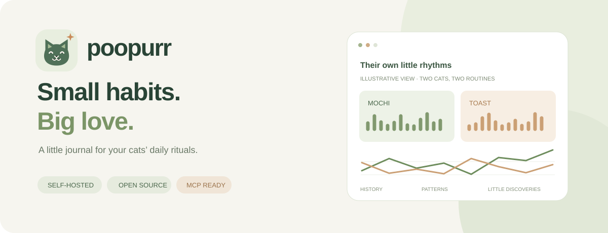

<div align="center">



# Poopurr · 猫咪如厕手账

**把猫咪的小日常，慢慢记下来。**

自部署的 PETKIT 猫砂盆观察工具：历史记录、多猫行为可视化，以及可以直接提问的 MCP。

[](https://github.com/DevRoss/poopurr/actions/workflows/ci.yml)
[](LICENSE)
[](package.json)
[](https://poopurr-demo.bushy-slug-1458.chatgpt.site)

### [🐾 打开互动 Demo](https://poopurr-demo.bushy-slug-1458.chatgpt.site)

**[快速开始](#快速开始)** · **[English](README.en.md)** · **[MCP 接入](#mcp)** · **[路线图](ROADMAP.md)**

</div>

---

## 先认识两位虚拟观察员

Demo 里的 **麻薯** 和 **吐司**，有各自的如厕节奏。无需注册或 PETKIT 账号，打开就能体验：

1. 切换 **7 / 14 / 30 天**，观察每天的次数变化。
2. 对比两只猫的 **小时热图、停留时长与分布**。
3. 在明细里 **手动校正** 一条记录，看看分析如何更新。

> Demo 全部使用固定的合成数据，不连接 PETKIT；标注只在当前页面生效。图表与时长分析复用正式应用的组件和算法。[运行自己的 Demo →](docs/DEMO.md)

## 小日常，也值得认真观察

| | 功能 | 你能看到什么 |
| :---: | --- | --- |
| 📅 | **历史补拉** | 按日期读取近 31 天记录，支持进度、暂停、重试和去重 |
| 🐈 | **每只猫的节奏** | 小时热图、每日观察次数、时长分布，各自统计与对比 |
| 🔎 | **有依据的分类** | 设备识别、人工标注、时长推测分开展示；未知保留为未知 |
| 💬 | **通过 MCP 提问** | 8 个只读工具，查询设备、猫咪、记录、趋势和行为分析 |
| 🏡 | **数据留在你的实例** | Cloudflare Workers + D1 自部署，一个家庭一份手账 |
| 🛡️ | **设备只读** | 不清理、不倒砂、不转动设备；标注只修改本应用数据 |

> **早期实验版 · 非 PETKIT 官方项目。** 仅凭停留时长不能确认大小便，推测不等于检测结果，也不用于诊断。[了解模型边界 →](docs/CLASSIFICATION.md)

## 快速开始

需要 Node.js **22.13+**（推荐 Node 24）和 npm。无需 ChatGPT/Sites 账号；本地模式无需 Cloudflare 登录。

```sh
git clone https://github.com/DevRoss/poopurr.git
cd poopurr
npm ci
npm run setup
npm run dev
```

打开 **http://localhost:8787**。从本地 `.dev.vars` 文件取出 `ACCESS_TOKEN` 登录本站，再在页面输入 PETKIT 账号、密码和正确地区。`npm run setup` 不会覆盖已有配置。不要把 `.dev.vars` 提交到 Git，也不要把访问密钥发在 Issue 中。

每个部署是**一个家庭**；持有同一访问密钥的人能看到同一套记录。让不同朋友分别部署各自的实例，不要把它当作多租户 SaaS。

## 部署到自己的 Cloudflare

1. `npx wrangler login`
2. `npx wrangler d1 create poopurr`
3. 将返回的数据库 ID 写入 `wrangler.jsonc` 的 `database_id`。
4. 设置 `vars.PUBLIC_ORIGIN` 为此 Worker 的完整 HTTPS 域名（没有尾部 `/`）。域名须与浏览器实际访问的 origin 完全一致。
5. 在密码管理器中生成并保存两个独立随机值：`ACCESS_TOKEN` 至少 32 字符；`PETKIT_SESSION_KEY` 为 32 字节随机值的 64 位小写十六进制。
6. 通过交互式命令设置生产密钥：

```sh
npx wrangler secret put ACCESS_TOKEN
npx wrangler secret put PETKIT_SESSION_KEY
npx wrangler d1 migrations apply DB --remote
npm run deploy
```

生产环境不要设置 `ALLOW_LOCAL_HTTP`。`.dev.vars` 仅用于本地开发，不会代替生产密钥。密钥丢失或随意轮换可能导致原有加密会话无法读取，请保管备份。D1 活动记录本身并非应用层加密；保护云账号及数据库导出。

上线后先检查 `/healthz`，再验证：未登录无法读 `/api/petkit`；登录后能连接；选择昨天可补拉；登出后无法读数据。**不要将测试通过说成所有型号实机兼容。**

## MCP

端点是 `https://你的域名/mcp`。在支持自定义请求头的 Streamable HTTP MCP 客户端中配置：

```json
{
  "url": "https://your-domain.example/mcp",
  "headers": {"Authorization": "Bearer <ACCESS_TOKEN>"}
}
```

这只是通用端点/请求头示例，各客户端配置文件结构不同。当前开源服务没有实现 OAuth 授权服务器；不能据此宣称可直接在所有 ChatGPT 客户端安装。既有私人 Sites 插件的 OAuth 和身份不在开源包中。

PETKIT 密码只在网页连接时使用，聊天工具不接收密码。对于范围同步，调用 `sync_litter_records` 后，若 `next_start_date` 非空，用它继续请求并保持原 `end_date`，直到为空。结束日期为**不包含**该日的上海日期。

## 型号与数据边界

| 型号协议 | 当前支持依据 |
| --- | --- |
| T4 | 私有试用中已验证历史日期读取；仍不能保证设备无漏报 |
| T3 | 协议与合成测试覆盖，等待实机验证 |
| T5 / T6 / T7 | 实验性目标日时间戳和有界分页，等待实机验证 |

上游是非官方接口，可能变更；登录可能使官方 App 或其他客户端退出。摄像头分页每来源最多 4 页；每设备每日最多保存 500 条；查询最多 5,000 条，限制会反映为部分/截断结果。空日期不补“确定为 0”。只读查询不代表不受上游频率限制。

[时长模型说明](docs/CLASSIFICATION.md) 包含样本门槛、低可信假设和已知局限。模型当前使用所选日期范围，切换范围可能改变推测。

## 开发与维护

```sh
npm run check
npx wrangler deploy --dry-run
node scripts/check-public-source.mjs
```

测试全部使用合成数据，不需要真实 PETKIT 账号。包含 workerd + D1 集成测试。GitHub Actions 对 Node 22/24 运行检查；Dependabot 准备每周检查 npm 依赖。实际启用以仓库发布后的配置与权限为准。

[架构](docs/ARCHITECTURE.md) · [维护政策](docs/MAINTENANCE.md) · [变更记录](CHANGELOG.md)

欢迎提供型号兼容反馈和脱敏复现。请勿上传真实账号、会话、设备 ID、猫咪活动日志或含隐私的截图。安全问题请按 SECURITY.md 私下报告。

## 许可与致谢

MIT，见 [LICENSE](LICENSE)。协议实现参考 [py-petkit-api](https://github.com/Jezza34000/py-petkit-api) 与 [mcp-server-petkit](https://github.com/dirkjanfaber/mcp-server-petkit)。上游许可与署名完整保留在 [THIRD_PARTY_NOTICES.txt](THIRD_PARTY_NOTICES.txt)。PETKIT 名称属于其权利人，本项目不代表官方。
